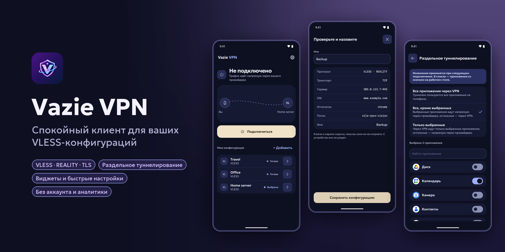
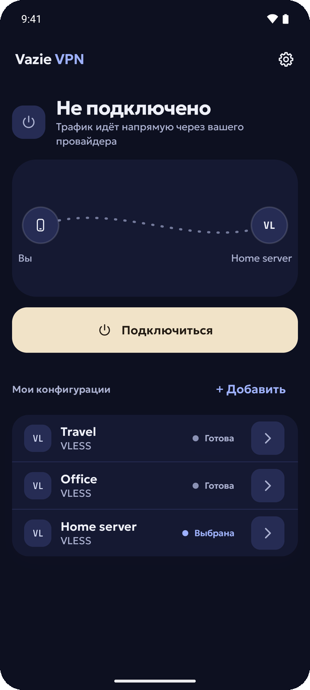
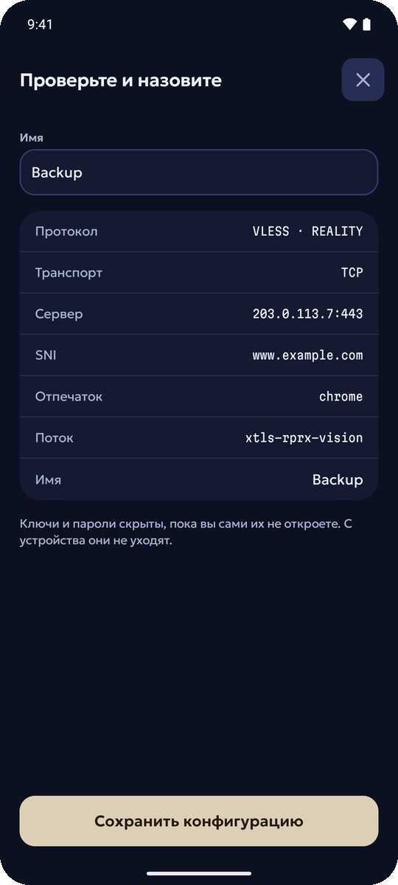
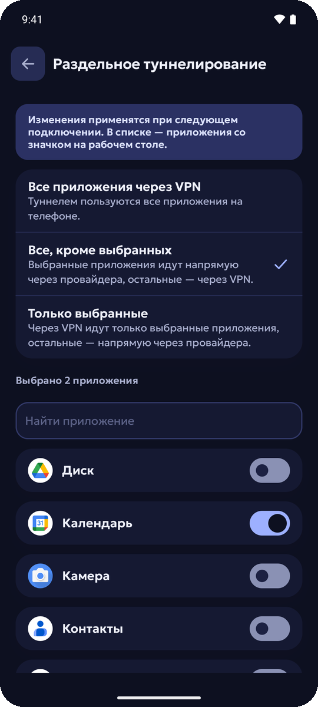
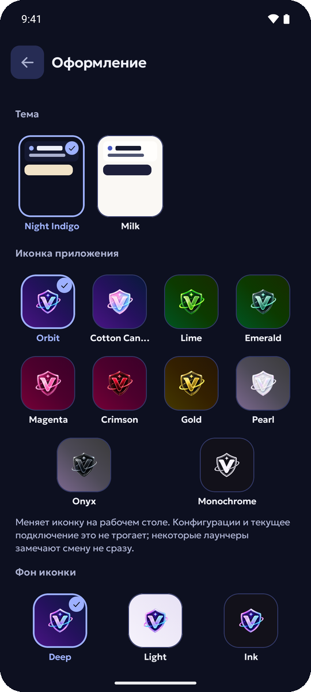

<div align="center">


# Vazie VPN

**Спокойный Android-клиент для ваших собственных VLESS-конфигураций.**

Добавьте конфигурацию или подписку от своего сервера или провайдера. Vazie VPN хранит её зашифрованной на телефоне и
подключается одним нажатием — без аккаунта, рекламы и аналитики.

[Установка](#установка) · [Сборка из исходников](#сборка-из-исходников) · [Приватность](#приватность) · [vazie.app](https://vazie.app)

[English](README.md) · **Русский**

<sub>Vazie VPN 1.0.0 — первый публичный выпуск</sub>

<br>



</div>

## Что умеет

Vazie VPN — это клиент. Серверов в нём нет: он подключается к VLESS-серверу, который у вас уже есть.

**Ваши конфигурации**
- Вставьте ссылку `vless://` или ссылку-подписку, в которой сразу несколько конфигураций.
- Безопасность REALITY и TLS, транспорт TCP, WebSocket и gRPC.
- Конфигурацию можно проверить перед сохранением; незнакомые приложению параметры сохраняются без изменений.
- Переименование, копия, экспорт и удаление. Рядом с каждой конфигурацией — задержка до сервера.

**Подключение**
- Подключение и отключение одним нажатием; состояние туннеля — в уведомлении.
- Раздельное туннелирование: все приложения через VPN, все кроме выбранных или только выбранные.

**Всегда под рукой**
- Два виджета для главного экрана — быстрое подключение и панель — в светлом и тёмном вариантах.
- Плитка в быстрых настройках.
- Недавние конфигурации — ярлыками на значке приложения.

**Удобно каждый день**
- Две темы, Milk и Night Indigo, и десять значков приложения.
- Короткие встроенные подсказки: импорт, уведомления, ярлыки.
- Русский и английский языки.

Чего нет: сканера QR-кодов, аккаунта и встроенного списка серверов. Протоколы, кроме VLESS, пока не
поддерживаются — приложение прямо называет, что не может запустить.

## Скриншоты

<div align="center">




</div>

Скриншоты сделаны в настоящем приложении на эмуляторе, с демонстрационными конфигурациями, которые указывают на
адреса для документации, а не на реальные серверы.

## Приватность

- **Без аккаунта.** Приложение не спрашивает, кто вы.
- **Конфигурации остаются на телефоне** и шифруются ключом из Android Keystore. Они никуда не загружаются, резервное
  копирование Android для приложения отключено.
- **Без аналитики, отчётов о сбоях, рекламы и трекеров.** Релизная сборка не соберётся, если такая библиотека в неё
  попадёт, а каждый релизный APK проверяется на их присутствие.
- **Что приложение отправляет:** на `api.vazie.app` — проверку новой версии, ссылки экрана «О приложении» и ответы на
  частые вопросы; ничего о вас, устройстве или конфигурациях. Подписка скачивается напрямую с её собственного сервера
  по HTTPS.
- **DNS:** внутри туннеля имена разрешаются через публичные серверы Cloudflare (`1.1.1.1`) и Google (`8.8.8.8`).

Полная политика конфиденциальности: [vazie.app/legal/privacy](https://vazie.app/legal/privacy).

VPN меняет то, кто видит ваш трафик, но не делает вас анонимным. Сервер, к которому вы подключаетесь, и его
провайдер видят ваши соединения.

## Установка

| | |
|---|---|
| **Скачать** | APK из [последнего выпуска](https://github.com/vazie-app/VazieVPN/releases/latest) — после его публикации |
| **Требования** | Android 9 или новее, arm64-v8a или armeabi-v7a |
| **Проверка** | В каждом выпуске указаны SHA-256 каждого APK и отпечаток сертификата подписи |

Если не знаете, какой файл подходит вашему телефону, скачайте `VazieVPN-universal.apk`. Устанавливайте APK только из
выпусков этого репозитория или с [vazie.app](https://vazie.app).

## Сборка из исходников

Нужны JDK 21 и Android SDK — оба есть в Android Studio.

```bash
git clone https://github.com/vazie-app/VazieVPN.git
cd VazieVPN
```

Создайте `local.properties` (git его игнорирует):

```properties
sdk.dir=/path/to/Android/sdk
vazie.api.url=https://api.example.com/v1
vazie.site.url=https://example.com
```

Это адреса, по которым приложение проверяет обновления и открывает веб-страницы. Сборка принимает любой адрес
`https`; официальная сборка использует `https://api.vazie.app/v1` и `https://vazie.app`.

```bash
./gradlew assembleDebug        # app/build/outputs/apk/debug/
./gradlew check                # тесты, lint и проверки проекта
./gradlew assembleRelease      # без подписи, если подпись не настроена (см. CONTRIBUTING.md)
```

Первая сборка скачивает движок Xray (libXray) из его выпуска на GitHub и проверяет SHA-256 перед использованием.

Вариантов сборки два: `debug` и `release`. Отладочная сборка ставится рядом с релизной как `app.vazie.vpn.debug`.

## Архитектура

Приложение на Jetpack Compose с одной Activity, разделённое на модули с проверяемыми границами.

| Модуль | Что внутри |
|---|---|
| `app` | Activity, навигация, внедрение зависимостей, виджеты, плитка быстрых настроек, ярлыки |
| `feature/*` | Экраны: `home`, `connections`, `config`, `settings`, `onboarding` |
| `vpn/api` | Контракты, которые видят экраны; ни одно поле не может хранить секрет |
| `vpn/config` | Разбор и запись ссылок VLESS |
| `vpn/runtime` | `VpnService` и туннель |
| `vpn/engine/xray` | Связка с Xray (libXray) |
| `data/*` | Зашифрованные профили, подписки, проверка обновлений, ссылки «О приложении» |
| `core/*` | Дизайн-система, модели, навигация, сеть, шифрование |

Правила между модулями — например, движок видит только `app`, а в сеть ходят только `app` и `data/*` — проверяются
при каждой сборке (`./gradlew checkModuleRules`).

## Безопасность

Об уязвимостях сообщайте приватно — см. [SECURITY.md](SECURITY.md). Не открывайте публичный issue о проблеме
безопасности и никогда не публикуйте конфигурацию или ссылку `vless://`: это учётные данные.

## Участие

Сообщения об ошибках и небольшие сфокусированные pull request'ы приветствуются — см. [CONTRIBUTING.md](CONTRIBUTING.md)
и [Кодекс поведения](CODE_OF_CONDUCT.md).

## Лицензия

Vazie VPN — свободное программное обеспечение под **GNU General Public License версии 3 или (по вашему выбору)
любой более поздней версии** — см. [LICENSE](LICENSE) и [NOTICE.md](NOTICE.md). Сторонние компоненты
распространяются на своих условиях: [THIRD_PARTY_NOTICES.md](THIRD_PARTY_NOTICES.md).

Названия «Vazie» и «Vazie VPN» и значки приложения как товарные знаки не лицензируются: форк использует своё
название и свои значки — см. [TRADEMARKS.md](TRADEMARKS.md).

## Автор

Делает **Vazovsky** — [vazie.app](https://vazie.app)

Поддержка: [support@vazie.app](mailto:support@vazie.app)
