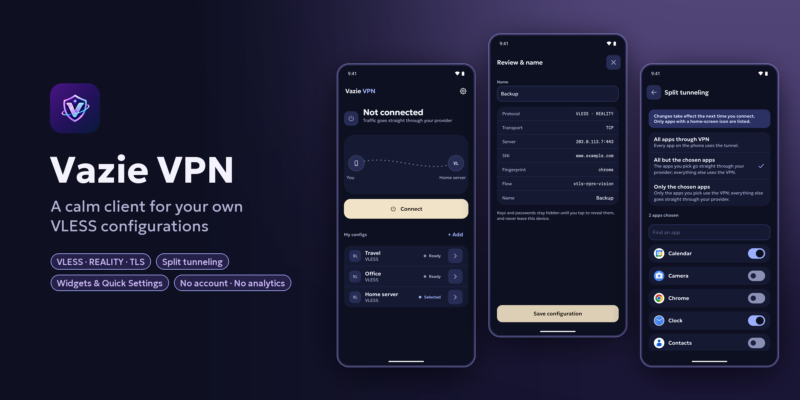
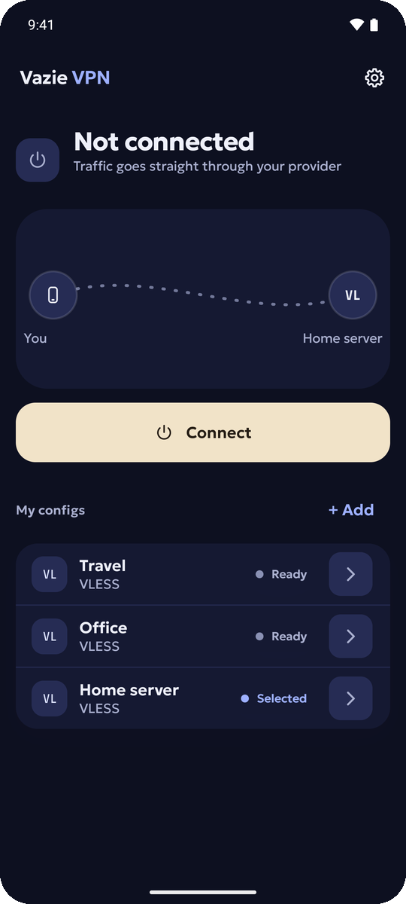
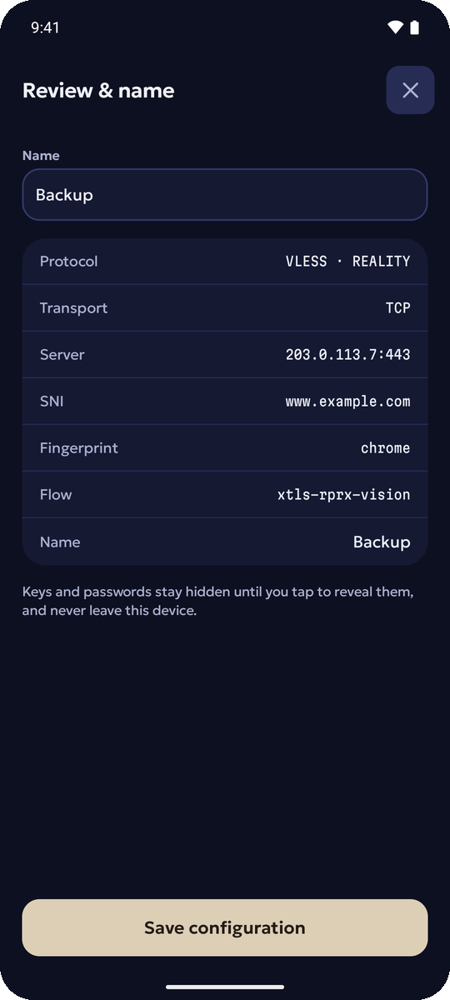
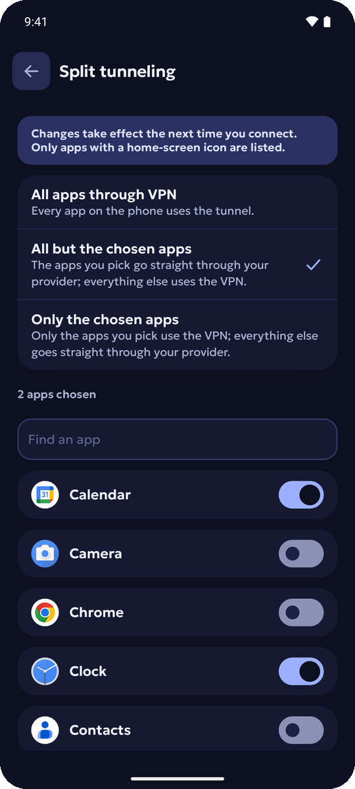
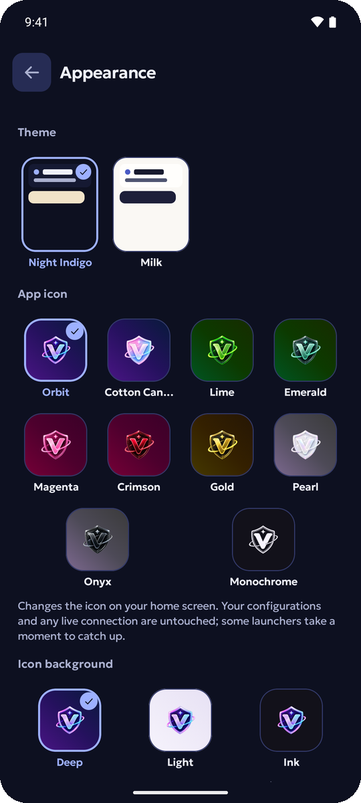

<div align="center">


# Vazie VPN

**A calm Android client for your own VLESS configurations.**

Bring a configuration or a subscription from your own server or provider. Vazie VPN keeps it encrypted on your
phone and connects in one tap — no account, no ads, no analytics.

[Install](#install) · [Build from source](#build-from-source) · [Privacy](#privacy) · [vazie.app](https://vazie.app)

**English** · [Русский](README.ru.md)

<sub>Vazie VPN 1.0.0 — Initial Public Release</sub>

<br>



</div>

## What it does

Vazie VPN is a client. It does not come with servers: it connects to the VLESS server you already have.

**Your configurations**
- Paste a `vless://` link, or a subscription link that lists several configurations at once.
- REALITY and TLS security, over TCP, WebSocket and gRPC.
- Review a configuration before saving it; parameters the app does not recognise are kept as they are.
- Rename, duplicate, export and delete. Latency is shown next to each configuration.

**Connection**
- One-tap connect and disconnect, with the tunnel's state in a notification.
- Split tunneling: every app through the VPN, every app except the ones you choose, or only the ones you choose.

**Always at hand**
- Two home-screen widgets — quick connect and a dashboard — in light and dark.
- A Quick Settings tile.
- Your recent configurations as app shortcuts.

**Made to be comfortable**
- Two themes, Milk and Night Indigo, and ten app icons.
- Short built-in guides to importing, notifications and launcher shortcuts.
- English and Russian.

What it does not do: there is no QR scanner, no account and no built-in server list. Protocols other than VLESS are
not supported yet; the app tells you by name what it cannot run.

## Screenshots

<div align="center">




</div>

All screenshots are taken from the real app on an emulator, with demonstration configurations that point at
documentation addresses — never at a real server.

## Privacy

- **No account.** The app never asks who you are.
- **Configurations stay on the phone**, encrypted with a key held in the Android Keystore. They are never uploaded,
  and Android backup is switched off for the app.
- **No analytics, crash reporting, advertising or tracking SDKs.** The release build refuses to compile if one
  reaches it, and every release APK is scanned for them.
- **What the app sends:** to the Vazie backend — a check for a newer version, the links on the About screen and the
  answers to common questions; nothing about you, your device or your configurations. A subscription link is
  downloaded directly from its own server over HTTPS.
- **DNS:** inside the tunnel, names are resolved through the public resolvers of Cloudflare (`1.1.1.1`) and Google
  (`8.8.8.8`).

The full privacy policy: [vazie.app/legal/privacy](https://vazie.app/legal/privacy).

A VPN changes who can see your traffic; it does not make you anonymous. The server you connect to, and its
provider, can see your connections.

## Install

| | |
|---|---|
| **Download** | The APK from the [latest release](https://github.com/vazie-app/VazieVPN/releases/latest) — once it is published |
| **Requires** | Android 9 or newer, arm64-v8a or armeabi-v7a |
| **Verify** | Each release lists the SHA-256 of every APK and the signing certificate's fingerprint |

Download `VazieVPN-universal.apk` if you are not sure which file is for your phone. Install only APKs from this
repository's releases or from [vazie.app](https://vazie.app).

## Build from source

You need JDK 21 and the Android SDK; Android Studio provides both.

```bash
git clone https://github.com/vazie-app/VazieVPN.git
cd VazieVPN
```

Create `local.properties` (it is ignored by git):

```properties
sdk.dir=/path/to/Android/sdk
vazie.api.url=https://api.example.com/v1
vazie.site.url=https://example.com
```

The two addresses are where the app checks for updates and opens web pages. Any `https` address builds; the
official build's addresses are set in the maintainer's release environment, not in this repository.

```bash
./gradlew assembleDebug        # app/build/outputs/apk/debug/
./gradlew check                # unit tests, lint and the project's own checks
./gradlew assembleRelease      # unsigned unless signing is configured (see CONTRIBUTING.md)
```

The first build downloads the Xray engine (libXray) from its GitHub release and checks its SHA-256 before using it.

There are two build variants, `debug` and `release`. A debug build installs beside the release one as
`app.vazie.vpn.debug`.

## Architecture

A single-activity Jetpack Compose app, split into modules with enforced boundaries.

| Module | What it holds |
|---|---|
| `app` | Activity, navigation, dependency injection, widgets, the Quick Settings tile, shortcuts |
| `feature/*` | Screens: `home`, `connections`, `config`, `settings`, `onboarding` |
| `vpn/api` | The contracts every feature sees; no field can hold a secret |
| `vpn/config` | The VLESS link parser and serializer |
| `vpn/runtime` | `VpnService` and the tunnel |
| `vpn/engine/xray` | The binding to Xray (libXray) |
| `data/*` | Encrypted profiles, subscriptions, update check, About links |
| `core/*` | Design system, models, navigation, networking, encryption |

The rules between modules — for example, only `app` sees the engine, only `app` and `data/*` reach the network —
are checked on every build (`./gradlew checkModuleRules`).

## Security

Please report vulnerabilities privately: see [SECURITY.md](../../SECURITY.md). Do not open a public issue for a
security problem, and never post a configuration or a `vless://` link — it is a credential.

## Contributing

Bug reports and focused pull requests are welcome: see [CONTRIBUTING.md](../../CONTRIBUTING.md) and the
[Code of Conduct](../../CODE_OF_CONDUCT.md).

## License

Vazie VPN is free software, licensed under the **GNU General Public License, version 3 or (at your option) any later
version** — see [LICENSE](../../LICENSE) and [NOTICE.md](NOTICE.md). Third-party components keep their own licenses:
[THIRD_PARTY_NOTICES.md](THIRD_PARTY_NOTICES.md).

The names "Vazie" and "Vazie VPN" and the app's icons are not licensed as marks: a fork uses its own name and icons —
see [TRADEMARKS.md](../../TRADEMARKS.md).

## Author

Made by **Vazovsky** — [vazie.app](https://vazie.app)

Support: [support@vazie.app](mailto:support@vazie.app)
